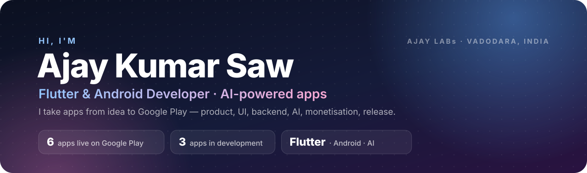
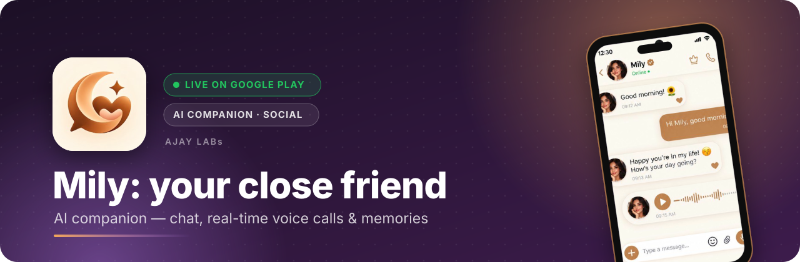
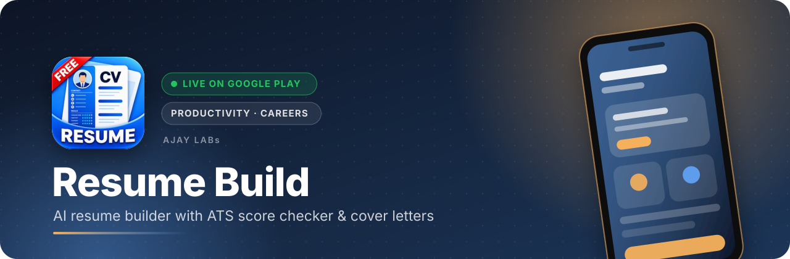
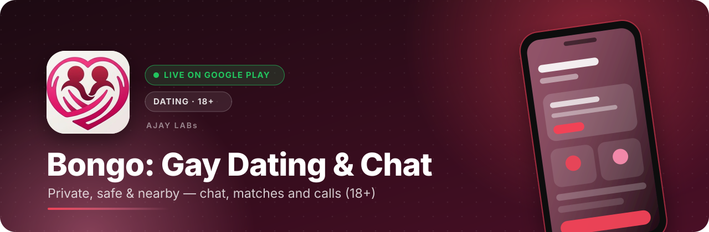
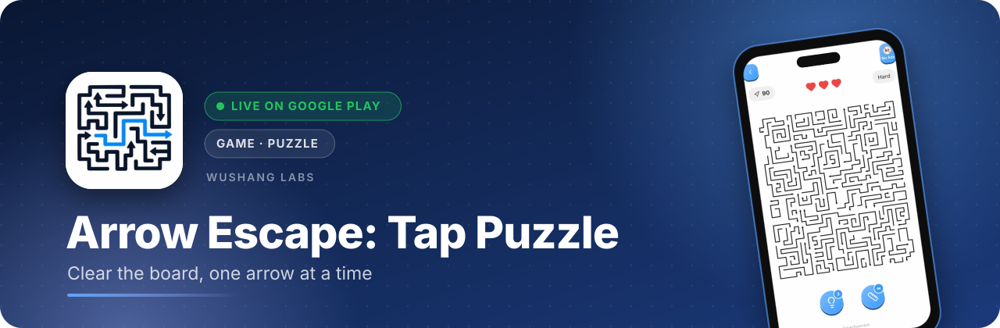
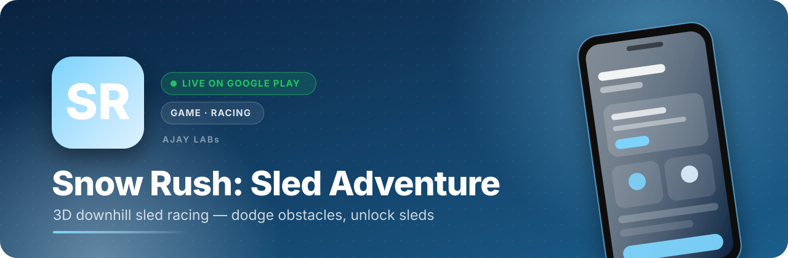
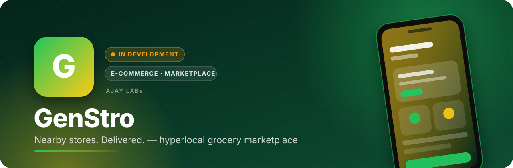
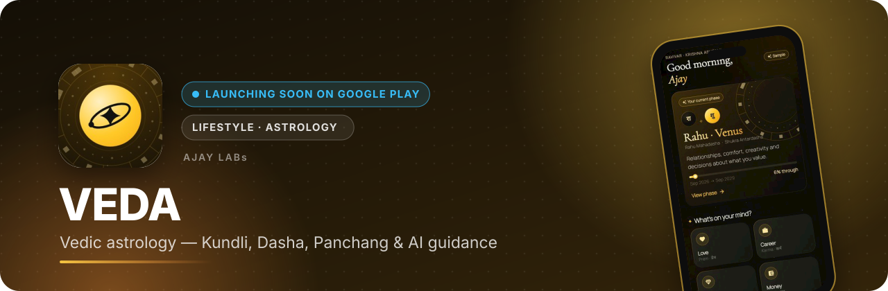
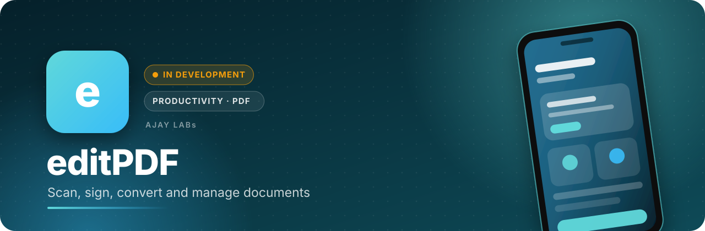

  
  
  

## 👨‍💻 About me

- 📱 Flutter & Android developer — I've shipped **5 apps to Google Play** under my studio **AJAY LABs**
- 🤖 I build AI into products: LLM chat with memory, **real-time AI voice calls**, AI resume writing, astrology chat
- 🧱 Comfortable across the stack: Firebase, Supabase, Cloud Functions, edge functions, security rules, testing
- 💰 I handle the business side too — subscriptions (RevenueCat, Play Billing), AdMob, ASO and Play Console releases
- 🎓 B.Tech CSE, Parul University (2022–2026) · 📍 Vadodara, India
- 🔎 **Open to Flutter / Android developer roles, internships and freelance projects**

## 🚀 Live on Google Play

<table>
<tr>
<td width="50%" align="center"> <b>Mily</b> — Your AI close friend — chat, voice calls & memories</td>
<td width="50%" align="center"> <b>Resume Build</b> — AI resume builder with ATS score checker & cover letters</td>
</tr>
<tr>
<td width="50%" align="center"> <b>Bongo</b> — Gay dating & chat — private, safe and nearby</td>
<td width="50%" align="center"> <b>Arrow Escape</b> — Tap puzzle game — clear the board, one arrow at a time</td>
</tr>
<tr>
<td width="50%" align="center"> <b>Snow Rush</b> — Sled downhill, dodge obstacles, unlock new sleds</td>
</tr>
</table>

## 🛠️ In development

<table>
<tr>
<td width="50%" align="center"> <b>GenStro</b> — Nearby stores. Delivered. — hyperlocal grocery marketplace</td>
<td width="50%" align="center"> <b>VEDA</b> — Vedic astrology — Kundli, Dasha, Panchang & AI guidance</td>
</tr>
<tr>
<td width="50%" align="center"> <b>editPDF</b> — Scan, sign, convert and manage documents</td>
</tr>
</table>

## ⚡ Tech stack

  
  
  
  
  
  
  
  
  
  
  
  
  
  
  
  
  
  
  

🔒 Project repos are product showcases — source code is private. Happy to walk through architecture and code in an interview.
